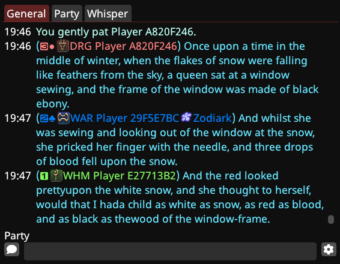
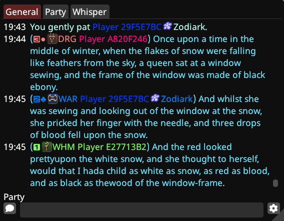

# GlassChat
#### A complete replacement for the in-game chat, on real glass.

GlassChat is a fork off [Chat 2](https://github.com/Infiziert90/ChatTwo), a complete rewrite of the in-game chat window as a plugin, with a refreshed glass UI.
It adds:

- A real glass window background, with themes
- Minimising the chat to just its input bar, with new messages shown briefly above it
- A resize grip in the top-right corner

And keeps everything from Chat 2:

- Unlimited tabs
- Tabs that always send to a certain channel
- More flexible filtering
- RGB channel colouring
- Completely variable font size
- Sidebar tabs
- Unread counts
- Emotes
- Screenshot mode (obfuscate names)

---

### Installing
1. In game, type `/xlsettings` and open the **Experimental** tab.
2. Under **Custom Plugin Repositories**, add
   `https://raw.githubusercontent.com/Abelss0n/GlassChat/main/pluginmaster.json`,
   tick **Enabled** and click the save icon.
3. Type `/xlplugins`, search for **GlassChat** and install it.

GlassChat replaces the game's chat the same way Chat 2 does, so disable Chat 2
if you have it installed.

### Releasing
1. Set `<Version>` in `GlassChat/GlassChat.csproj` and commit.
2. Push a matching tag: `git tag v0.1.0` then `git push origin v0.1.0`.

The [Release workflow](.github/workflows/release.yml) builds the plugin,
attaches it to a GitHub Release and updates `pluginmaster.json`, so players get
the update in game.

---

### Chat Window

### With SimpleTweaks "Chat Name Colors"

---

### IPC Integration
Other plugins can easily integrate their functionality into the context menu of GlassChat
For more infos read [IPC Guide](ipc.md)

---

### Thanks to
The original dev Anna~, Infi and everyone who built [Chat 2](https://github.com/Infiziert90/ChatTwo), which GlassChat is based on. Licensed under the EUPL-1.2, see [LICENCE](LICENCE).
